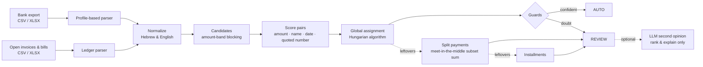

# Tally

[](https://github.com/<your-username>/tally/actions/workflows/ci.yml)

**Bank reconciliation engine for small businesses.** Tally reads a bank statement export and a list of open invoices and bills, and works out which payment settles which document. Confident matches are posted automatically; everything else goes to a review queue with the reasons and the alternatives.

On a 1,921-transaction benchmark it auto-matches 64% of payments at **99.7% precision**, finds 82% overall, and runs in about a second.

## Why this is hard

Matching a bank line to an invoice looks like a join on the amount. In practice:

| Problem | Example |
| --- | --- |
| The bank truncates and decorates names | `העברה מ-גלבוע ציוד מש` for *גלבוע ציוד משרדי בע"מ* |
| Same customer, same amount, every month | three open invoices of ₪566.40 from one customer |
| Similar names, different companies | *כרמל תוכנה* and *כרמל תעשיות מתכת* |
| Fees deducted on the way | invoice ₪1,770.00, received ₪1,762.50 |
| One transfer, several invoices | ₪4,130 = ₪1,770 + ₪2,360 |
| One invoice, several transfers | installments of 40% and 60% |
| The description says nothing | `העברה בנקאית` |

A wrong automatic match corrupts the books silently, which is worse than no match. So the engine optimizes for precision on what it posts, and for useful suggestions on what it does not.

## How it works



**1. Parsing.** Every bank exports differently: title lines above the header, totals below, Hebrew or English headers, one signed column or separate debit/credit columns, UTF-8 or Windows-1255. A *profile* ([`profiles/`](src/tally/profiles)) describes a layout as data, so a new bank is a JSON file, not code. Transaction ids are content hashes, so importing the same statement twice yields the same ids, while two genuinely identical payments on one day stay distinct.

**2. Candidates with blocking.** A payment must agree on direction and, within the fee tolerance, on amount. Entries are indexed by amount, so each transaction scores only a narrow band: about 6,300 pairs instead of 3.6 million on the benchmark.

**3. Scoring.** Each pair gets a weighted score from amount fit (exact, or short by a plausible fee), name similarity (prefix-aware, because banks truncate), and date fit (between issue date and due date, decaying outside). A quoted document number adds a strong bonus. Amount and date alone are penalized: that is a coincidence waiting to happen.

**4. Global assignment.** Greedy matching fails when two customers pay the same amount in the same week. Candidate pairs form a bipartite graph; each connected component is solved with the Hungarian algorithm (`scipy.optimize.linear_sum_assignment`) to maximize total score.

**5. Guards.** A high score is not enough to auto-post. A match goes to review when:
- a competing candidate scores within 0.08;
- the same counterparty has another open entry for the same amount whose dates also fit;
- the transfer quotes a different document number.

**6. Split payments.** For leftover transactions, the engine looks for a combination of one counterparty's open entries that sums to the payment. That is subset-sum, so it uses an exact meet-in-the-middle search capped at 24 candidates (2 × 4,096 partial sums). It auto-posts only when the combination is unique, the pool is small and untruncated, and no same-amount twin could be swapped in.

**7. Installments.** Partial payments are linked to the entry they reduce. A later payment that settles exactly the remaining balance is recognized as the final installment.

**8. Optional LLM second opinion.** With `--llm`, review items that have alternatives are sent to Claude with the candidate list. The model can only choose among the engine's options (any other answer is discarded), can only reorder suggestions and explain them, and never promotes anything to AUTO. Calls are capped per run.

## Results

Real bank statements cannot be published, so [`synthetic.py`](src/tally/synthetic.py) generates realistic data with ground truth: six months of a small Israeli business with Hebrew and English counterparties, 18% VAT prices, monthly retainers, truncated and misspelled descriptions, fees, split payments, installments, unpaid invoices and unrelated bank lines (salaries, VAT, card charges, bank fees). The whole pipeline runs end to end, including writing and re-parsing the bank file.

Seed 7 (1,921 transactions, 1,859 open entries, 1,568 true links):

| Metric | Value |
| --- | --- |
| Auto-match precision | **99.7%** (1,009 of 1,012) |
| Auto-match recall | 64.3% of all true links |
| Found (auto + review) | 81.9% |
| Review: right entry among top 3 options | 78.9% |
| Unrelated bank lines wrongly linked | 1 of 353 |
| Runtime | about 1 second |

| Scenario | Links | Auto, correct | Review, correct | Wrong | Missed |
| --- | ---: | ---: | ---: | ---: | ---: |
| clean | 928 | 739 | 116 | 66 | 7 |
| reference quoted | 182 | 173 | 2 | 4 | 3 |
| fee deducted | 101 | 72 | 22 | 6 | 1 |
| split payment | 83 | 25 | 21 | 34 | 3 |
| installments | 192 | 0 | 114 | 74 | 4 |
| no payer in description | 82 | 0 | 0 | 2 | 80 |

Seeds 11 and 42 give 99.6% and 99.7% auto precision; see [`benchmarks/results.md`](benchmarks/results.md). CI fails if precision on seed 7 drops below 99%.

What the numbers say:
- Nearly all errors sit in the review queue, where a person checks them; only 3 automatic matches out of 1,012 are wrong.
- Most review errors are genuinely ambiguous: same customer, same amount, overlapping dates. The right answer is usually one of the alternatives shown.
- Transfers whose description names no payer are left unmatched on purpose.

## Usage

```bash
pip install -e ".[api,dev]"

# reconcile your own files
tally reconcile statement.csv open_items.csv --profile hebrew_debit_credit --show-review --out report.json

# try it on the included sample, or generate a full dataset
tally reconcile data/samples/statement.csv data/samples/open_items.csv --show-review
tally generate data/generated --seed 7

# reproduce the benchmark
tally benchmark --seeds 7 11 42
```

```text
60 transactions, 56 open entries
  matched automatically: 43 (72%)
  need review:           6
  unmatched:             11 transactions, 8 entries
```

### API

```bash
uvicorn tally.api:app --reload        # or: docker build -t tally . && docker run -p 8000:8000 tally
curl -F bank_file=@data/samples/statement.csv -F ledger_file=@data/samples/open_items.csv \
     http://localhost:8000/reconcile
```

Interactive docs at `http://localhost:8000/docs`. Endpoints: `GET /health`, `GET /profiles`, `POST /reconcile`.

Every match in the response carries `status` (`auto` or `review`), `confidence`, `reasons`, `amount_difference` and `alternative_entry_ids`.

### Ledger format

```csv
id,kind,number,counterparty,amount,issue_date,due_date
I1,invoice,INV-260142,"גלבוע ציוד משרדי בע""מ",1770.00,2026-02-01,2026-03-03
B1,bill,88123,תקשורת פלוס,1250.00,2026-02-01,2026-02-10
```

`kind` is `invoice` (money expected in) or `bill` (money expected out).

## Project layout

```
src/tally/
  parsing/      bank and ledger readers, cell parsing, export profiles
  normalize.py  Hebrew/English name normalization and similarity
  matching/
    candidates.py   amount-band blocking
    scoring.py      pair score and configuration
    assignment.py   connected components + Hungarian algorithm
    split.py        meet-in-the-middle subset sum
    references.py   which documents a transfer quotes
    engine.py       the passes and the auto/review guards
  resolver.py   optional LLM second opinion with guardrails
  synthetic.py  data generator with ground truth
  evaluation.py precision/recall benchmark
  api.py, cli.py
tests/          103 tests, including a property test of subset search against brute force
```

## Engineering notes

- **Money is `Decimal`**, never `float`; subset search runs on integer agorot.
- **Strict typing** (`mypy --strict`), `ruff` lint and format, CI on Python 3.11–3.13.
- **Deterministic**: the same input and seed give the same output.
- **Explainable**: every match lists why it was made and why it was or was not auto-posted.

## Limitations and next steps

- Single currency (ILS); no FX matching yet.
- Profiles cover two generic layouts; real exports from specific banks need their own profile files.
- Scoring weights are set by hand and checked against the benchmark; learning them from labeled reviews (logistic regression) is the natural next step.
- Reviewer decisions are not persisted. A database (PostgreSQL) and a small review UI would close the loop.
- Many-to-many cases (several transfers paying several invoices) are not handled.

## License

MIT © Shoham Moyal
